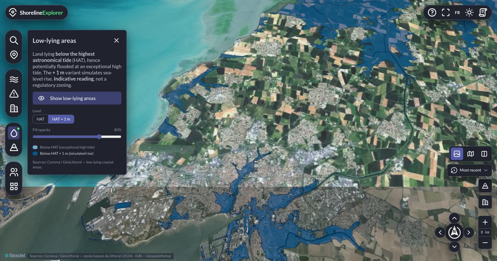

# Shoreline Explorer — coastal erosion in France, in 3D

An experimental explorer of **coastal erosion and coastline retreat** along the
shores of metropolitan France, in English and French. See how the coastline has
moved, where it could be in 2050 and 2100, and what lies in its path, on a 3D map
in the browser.

[](https://siradel-oss.github.io/horizon-demo-coastline-erosion/)

**[▶ Live demo](https://siradel-oss.github.io/horizon-demo-coastline-erosion/)**

## Features

- Historical and recent coastlines, national coastal erosion indicator (Cerema)
- Shoreline retreat projections for 2050 and 2100, and event-driven retreat
  (storms)
- Coastal low-lying areas below the highest astronomical tide (HAT and HAT + 1 m)
- Exposed population, buildings, land use and coastal structures
- Sea level simulation: raise the water height on the 3D terrain
- Erosion hotspots, guided tour, side-by-side comparison of aerial imagery
- 3D terrain and IGN imagery, address search, dark / light theme, English /
  French interface

## Built with Horizon

Shoreline Explorer is a demo of [Horizon](https://github.com/siradel-oss/horizon),
Siradel's open source real-time 3D engine for map data on a globe (WebAssembly,
WebGL 2, TypeScript). It shows how an Angular application drives Horizon to style
large PMTiles vector datasets over streamed terrain and imagery.

- Horizon: [website and documentation](https://horizon.oss.siradel.com) ·
  [getting started](https://horizon.oss.siradel.com/doc/getting_started.html) ·
  npm packages `@siradel-oss/horizon-{api,core,protocol}`
- More Horizon demos:
  [IGN Explorer](https://github.com/siradel-oss/horizon-demo-ign-geoplateforme)
  (IGN Géoplateforme catalogue in 3D) ·
  [Reunion Island Explorer](https://github.com/siradel-oss/horizon-demo-reunion-island)
  (3D hiking trails of La Réunion)

> **A demonstrator.** Horizon grew out of the [SCE](https://sce.oss.siradel.com)
> ecosystem. The framework of Shoreline Explorer draws on the 2024 Cerema study
> _« Projection du trait de côte et analyse des enjeux au niveau national,
> horizons 2050 et 2100 »_. It is still an experiment, so the data processing may
> contain small errors.

## En français

Shoreline Explorer est un explorateur expérimental de **l'érosion côtière** et du
**recul du trait de côte** en France métropolitaine : traits de côte historiques,
indicateur national d'érosion, projections à 2050 et 2100, zones basses
littorales et enjeux exposés (population, bâti, occupation du sol), sur une carte
3D. Inspiré de l'étude Cerema de 2024, démonstrateur du moteur 3D open source
Horizon, interface en français et en anglais.

## Run it

Requirements: Node.js ≥ 22.22, pnpm ≥ 10, and a browser with WebGL 2 and
`SharedArrayBuffer`.

```bash
pnpm install
pnpm dev        # http://localhost:5173
```

| Command        | Description               |
| -------------- | ------------------------- |
| `pnpm dev`     | Development server        |
| `pnpm build`   | Static build into `dist/` |
| `pnpm preview` | Serves the build locally  |

To deploy under a subpath, set the Vite base at build time
(`pnpm build --base=/horizon-demo-coastline-erosion/`). All runtime URLs (data, WASM, fonts)
are resolved relative to it.

### Serving requirements

Horizon runs its WASM core across threads, which requires `SharedArrayBuffer`.
The static server must therefore send these headers on every response:

```
Cross-Origin-Opener-Policy: same-origin
Cross-Origin-Embedder-Policy: require-corp
```

It must also serve `hrz_core.wasm` as `application/wasm`. The dev and preview
servers already do both (see `vite.config.ts`).

Hosts that cannot set headers, such as GitHub Pages, rely on the bundled
[coi-serviceworker](https://github.com/gzuidhof/coi-serviceworker) (MIT), which adds
them client-side. The `.github/workflows/deploy.yml` workflow builds and publishes
the app to GitHub Pages on every push to `main`, using the base path Pages assigns.

## Stack

- [Horizon](https://horizon.oss.siradel.com): `@siradel-oss/horizon-{api,core,protocol}`
- Angular 22 (standalone components, signals, zoneless), compiled through
  `@analogjs/vite-plugin-angular`
- Vite 7, Tailwind CSS 4, TypeScript 6

```
src/
├── app.ts            # Root component: Horizon canvas, header, tool rail, panels
├── i18n.ts           # Runtime EN/FR switch; strings sit next to their component
├── horizon.service.ts
├── layers.ts         # Entry point of the Horizon layer modules (layers/*)
├── layout/           # Tool panels (coastline, risk zones, low-lying areas…)
└── components/       # UI primitives
public/data/          # Pre-generated PMTiles and JSON summaries
resources/            # Vendored fonts and SVGs, copied to the build root
```

## Data

Open data only. The PMTiles in `public/data/` were generated from the source
datasets below; the IGN layers are streamed at runtime.

| Producer                              | Datasets                                                                                                                                                                                                                  | License                                    |
| ------------------------------------- | ------------------------------------------------------------------------------------------------------------------------------------------------------------------------------------------------------------------------- | ------------------------------------------ |
| Cerema, through GéoLittoral           | National coastal erosion indicator (06/2018), old and recent natural coastlines, coastal structures and developments (11/2017), coastal low-lying areas below HAT and HAT + 1 m (07/2024), event-driven retreat (04/2024) | Licence Ouverte 2.0                        |
| INSEE                                 | Filosofi 2019, population on a 200 m grid                                                                                                                                                                                 | Licence Ouverte 2.0                        |
| Copernicus (EEA), distributed by SDES | CORINE Land Cover 2018                                                                                                                                                                                                    | Copernicus free, full and open data policy |
| IGN, Géoplateforme                    | Orthoimagery, Plan IGN, RGE ALTI®, BD TOPO® buildings and place names, ADMIN EXPRESS, address search                                                                                                                      | Licence Ouverte 2.0                        |
| NASA                                  | SRTM3 elevation, served by IGN Géoplateforme                                                                                                                                                                              | Public domain                              |

CORINE Land Cover: © European Union, Copernicus Land Monitoring Service 2018,
European Environment Agency (EEA).

**Derived information.** Several layers are computed by this application and are
neither published nor validated by their producers:

- 2050 / 2100 retreat zones and impact depth: linear extrapolation of the 2018
  erosion indicator (rate × years since 2018), clipped to the land;
- event-driven retreat band: each coastline segment buffered by its reference
  retreat, clipped to the land;
- exposed population, assets at stake and land-use categories: crossings of the
  hazard zones with INSEE Filosofi and CORINE Land Cover;
- low-lying areas: smallest polygons dropped and detail reduced for display.

The same list is available in the in-app **Attributions** panel.

## License

Code: [MIT](LICENSE). Data keeps the licence of its producer (see above).
Shoreline Explorer is not affiliated with Cerema.
Bundled fonts (Lato, Source Sans 3) are under the SIL Open Font License, and the
icons come from Tabler Icons (MIT). Their licence files are in `resources/`.

## Contact

Siradel open source: [opensource@siradel.com](mailto:opensource@siradel.com) ·
[www.siradel.com](https://www.siradel.com)
